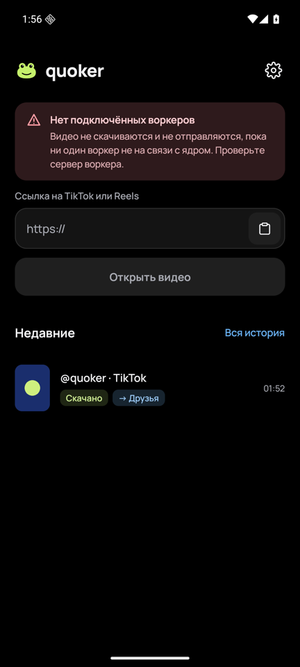
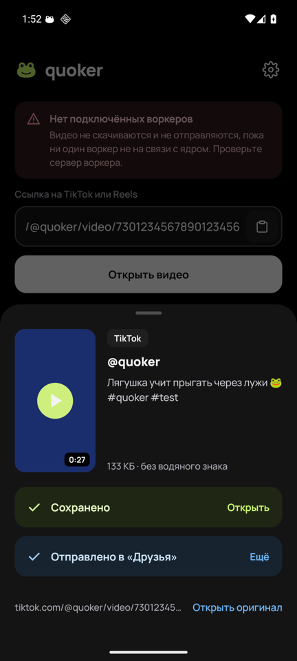
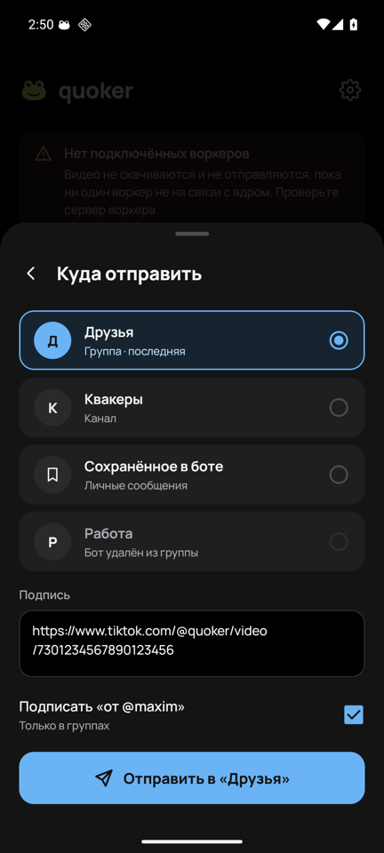
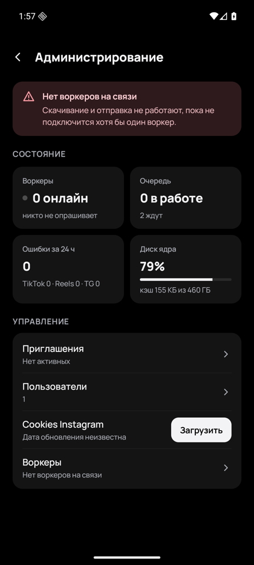
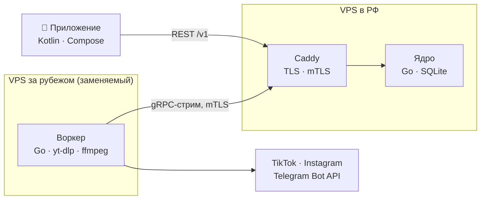

<div align="center">


# quoker

**Ролики из TikTok и Reels — в галерею или в Telegram за три тапа.**

Закрытое Android-приложение для себя и друзей: «Поделиться» → Quoker → «Скачать» или «Отправить в Telegram».


</div>

<br>

<table align="center">
  <tr>
    <td align="center"><br><sub>Главный экран</sub></td>
    <td align="center"><br><sub>Скачано и отправлено</sub></td>
    <td align="center"><br><sub>Куда отправить</sub></td>
    <td align="center"><br><sub>Администрирование</sub></td>
  </tr>
</table>

## Что умеет

- 📥 **Приём ссылок** — из меню «Поделиться» в TikTok и Instagram или вставкой; ссылка вытаскивается из любого текста.
- 💾 **Скачать** — в `Movies/Quoker/` через MediaStore: в фоне, с прогрессом, отменой и докачкой. TikTok — без водяного знака.
- ✈️ **Отправить в Telegram** — через бота в свой канал, группу или «Сохранённое в боте»; подпись со ссылкой на оригинал и «от @username» в группах. Файл не проходит через телефон.
- 🕘 **История** — что скачивалось и куда отправлялось; скачать снова или повторить неудачную отправку в ту же цель.
- 🎟️ **Только по приглашениям** — одноразовые коды на 7 дней, блокировка пользователей, без публичной регистрации.
- 🔄 **Обновления сами** — APK раздаётся с сервера; приложение предлагает обновиться и умеет требовать обязательное обновление.
- 🛠️ **Администрирование** — в приложении и в боте: приглашения, пользователи, воркеры, cookies Instagram, алерты в Telegram.

Поддерживаются публичные видео TikTok и Instagram Reels (и посты с одним видео). Фото, карусели, сторис и эфиры — нет.

## Как устроено



- **Ядро** — единственная точка входа для приложения: API, очередь задач, кэш видео на 24 часа, вся логика бота, алерты. Само во внешние сервисы не ходит.
- **Воркер** держит с ядром один исходящий gRPC-стрим по mTLS, берёт задачи (резолв, скачивание, `sendVideo`, `getUpdates`) и заливает файлы обратно в ядро. Если его IP заблокируют, воркер заменяется за полчаса; на этот случай есть запасной транспорт REALITY.
- **Приложение** общается только с ядром, поэтому работает без VPN.

Подробнее — в [`docs/02-architecture.md`](docs/02-architecture.md).

## Стек

| Часть | Технологии |
| --- | --- |
| Ядро и воркер | Go, `chi`, gRPC + buf, `modernc.org/sqlite`, `log/slog`, Prometheus-метрики |
| Воркер | yt-dlp, ffmpeg |
| Android | Kotlin, Jetpack Compose, Material 3, Hilt, Retrofit + OkHttp, kotlinx.serialization, Room, DataStore, WorkManager, Coil 3, Navigation Compose |
| Инфраструктура | Docker Compose, Caddy (Let's Encrypt), собственный CA для воркеров, GitHub Actions + GHCR |

## Структура репозитория

```
api/openapi.yaml      публичный API ядра
proto/                контракт ядро ↔ воркер (buf)
gen/                  сгенерированный Go-код (не править руками)
cmd/core, cmd/worker  точки входа
internal/core/…       ядро: API, бот, очередь, хранилище, алерты
internal/worker/…     воркер: связь с ядром, yt-dlp, Telegram
internal/shared/…     нормализация ссылок, ошибки, логирование
core/migrations/      SQL-миграции
android/              Android-клиент (app.quoker)
docs/                 спецификация — источник правды
```

## Разработка

Нужны Go 1.26+, [buf](https://buf.build), golangci-lint; для клиента — JDK 21 и Android SDK 37.

```sh
make gen          # buf generate для proto
make test         # go test -race ./...
make lint         # golangci-lint run
make build        # бинарники в bin/

cp .env.example .env.local
make run-core     # локальное ядро
make run-worker   # локальный воркер (нужен yt-dlp)
```

```sh
cd android
./gradlew assembleDebug testDebugUnitTest lint
```

Debug-сборка ходит в API по `http://10.0.2.2:8080` — так эмулятор видит компьютер. Другой адрес задаётся свойством `-Pquoker.apiBaseUrl=…`.

## Документация

| | |
| --- | --- |
| 🧭 [Руководство администратора](docs/admin-manual.md) | Первый запуск, приглашения, воркеры, cookies, алерты, выпуск APK |
| [01 · Продукт](docs/01-product.md) | Роли, сценарии, функциональные требования |
| [02 · Архитектура](docs/02-architecture.md) | Компоненты, потоки данных, ключевые решения |
| [03 · Публичный API](docs/03-public-api.md) | REST API ядра, коды ошибок, лимиты |
| [04 · Протокол ядро ↔ воркер](docs/04-core-worker-protocol.md) | gRPC-стрим, задачи, аренды |
| [05 · Модель данных](docs/05-data-model.md) | Схема SQLite |
| [06 · Telegram-бот](docs/06-telegram-bot.md) | Привязка, цели, команды, алерты |
| [07 · Скачивание](docs/07-downloading.md) | yt-dlp, форматы, cookies, ошибки |
| [08 · Android](docs/08-android.md) | Модули, экраны, состояния, обновления |
| [09 · Дизайн](docs/09-design.md) | Токены, типографика, макеты |
| [10 · Деплой](docs/10-deploy.md) | Серверы, контейнеры, сертификаты, CI/CD, ранбуки |
| [11 · НФТ и безопасность](docs/11-nfr-security.md) | Производительность, безопасность, лимиты, наблюдаемость |
| [12 · Тестирование](docs/12-testing.md) | Стратегия и критерии приёмки |
| [`api/openapi.yaml`](api/openapi.yaml) | Публичный API в формате OpenAPI |
| [`link.proto`](proto/quoker/link/v1/link.proto) | Контракт ядро ↔ воркер |
| [Макеты](docs/design/mockups/) | Утверждённые экраны приложения |
| [`CLAUDE.md`](CLAUDE.md) | Правила работы для Claude Code |

## Статус

| | |
| --- | --- |
| ✅ Ядро, воркер, бот | Готовы, покрыты тестами |
| ✅ Android-клиент | Готов, проверен на эмуляторе против локального ядра |
| 🚧 Развёртывание | `deploy/` (bootstrap, compose, Caddyfile, REALITY), CI/CD и `make dev` — в работе |

## Безопасность

Токен бота, cookies Instagram, ключи и сертификаты никогда не попадают в репозиторий: токен и cookies хранятся в БД ядра, в репозитории — только `.env.example`. Воркеры подключаются по mTLS с сертификатами собственного CA, сессии на телефоне зашифрованы ключом из Android Keystore. Подробно — в [`docs/11-nfr-security.md`](docs/11-nfr-security.md).

<div align="center">
<sub>Личный проект. Сделано с 🐸 для себя и друзей.</sub>
</div>
